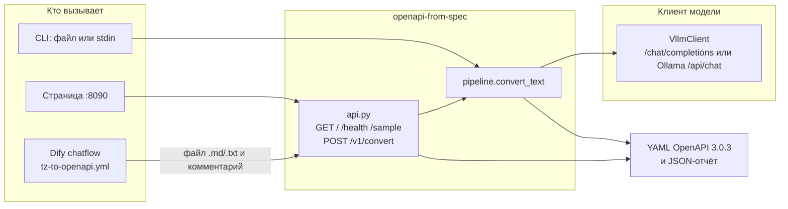
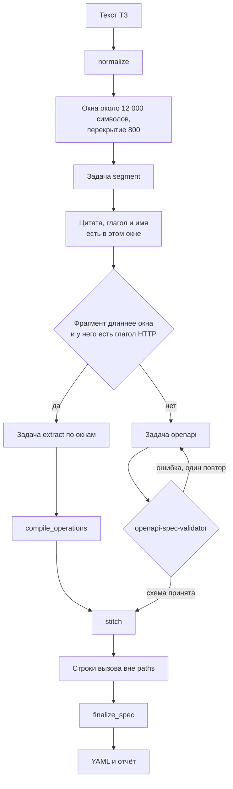

# ТЗ → OpenAPI 3.0.3

Отдельный сервис. Он не входит в RAG и не ищет по индексу: на вход приходит полный текст технического задания, на выход — YAML OpenAPI 3.0.3 и отчёт о пробелах.

Большое ТЗ не отправляется в модель целиком. Код режет текст окнами, проверяет, что цитаты границ есть в окне, сшивает `paths` и одинаковые схемы и проверяет сборку пакетом `openapi-spec-validator`. Без модели документ на методы не режется: в `paths` ничего не попадает, в отчёте остаётся вопрос.

## Архитектура



Страница и CLI отдают YAML вместе с отчётом. Chatflow Dify получает либо файл `openapi.yaml`, либо JSON `result=need_info`, если остались пробелы, методы без глагола HTTP или ошибки схемы. Адрес модели в браузер не попадает: его задаёт окружение сервера.

Модель вызывает только `VllmClient`: нужны `OPENAPI_VLLM_BASE_URL` и `OPENAPI_VLLM_MODEL`.



| Модуль | Роль |
|---|---|
| `cli.py` | Файл, stdin, `--serve`, коды выхода |
| `api.py` | HTTP, JSON и multipart, ответ для Dify |
| `pipeline.py` | Окна, вызовы модели, докрытие вызовов, `finalize_spec` |
| `segment.py` | Нормализация, окна, хвост таблицы того же метода |
| `llm.py` | `VllmClient` |
| `skill_loader.py` | Системный запрос под одну задачу |
| `extract.py`, `tables.py`, `naming.py` | Разбор длинного метода: секции, таблицы, путь |
| `compile.py` | `Operation` длинного метода в YAML |
| `stitch.py` | Слияние фрагментов и конфликт имён |
| `validate.py` | Схема OpenAPI 3.0.3 и ссылки |
| `models.py` | `Segment`, `Operation`, `IRField`, `Gap`, `ConvertResult` |

`probe/` и `docling/` в рантайм не входят: это прогоны и исходные ТЗ.

## Что сделать один раз

```powershell
cd c:\Technokratos\openapi-from-spec
python -m venv .venv
.\.venv\Scripts\python -m pip install -e .
```

Проверка примера без модели:

```powershell
.\.venv\Scripts\openapi-from-spec examples\account-balances.txt -o out\account-balances.yaml --report out\report.json --title "Счета"
```

Страница для вставки текста: `openapi-from-spec --serve`, затем открыть `http://127.0.0.1:8090`.

`POST /v1/convert` принимает JSON `{text, title, clarification}`, сырой UTF-8 или multipart. JSON-ответ страницы: `{yaml, report, errors}`. Ещё есть `GET /health` и `GET /sample`. Тело больше 15 МБ сервер не берёт.

Коды CLI: `2` — ошибки схемы, `3` — при `--strict` остались вопросы по ТЗ.

## Модель

Окна уходят в `VllmClient`. `OPENAPI_VLLM_BASE_URL` уже содержит `/v1`, клиент дописывает `/chat/completions`. Локальный Ollama (порт `11434` или путь `/api`) идёт в `POST /api/chat`.

```powershell
$env:OPENAPI_VLLM_BASE_URL = "http://127.0.0.1:8000/v1"
$env:OPENAPI_VLLM_MODEL = "имя-модели"
$env:OPENAPI_VLLM_API_KEY = "ключ-если-нужен"
.\.venv\Scripts\openapi-from-spec --serve --host 0.0.0.0
```

Образец переменных — `.env.example`. Процесс сам файл не читает: переменные должны быть в окружении.

## Dify как чат

Chatflow в этом разделе сам вызывает сервис.

В каталоге `dify/` один chatflow, `dify/tz-to-openapi.yml`. Импорт в студии: Import DSL, затем публикация. Сценарий забирает из чата файл и текст сообщения и отправляет их в `POST /v1/convert`: файл в поле `file`, комментарий в поле `clarification`. Ответ сервиса возвращается в чат.

Переменная `OPENAPI_SERVICE_URL` по умолчанию `http://host.docker.internal:8090`: так контейнер Dify видит сервис на хосте. Если Dify на другой машине, подставьте доступный адрес.

Пользователь прикладывает в чат файл `.md`, `.txt` или `.markdown` и пишет комментарий. Если в ТЗ остались вопросы, методы без глагола HTTP или ошибки проверки OpenAPI, сервис отвечает JSON `result=need_info` с текстом `message`. Если сборка чистая, ответ — файл `openapi.yaml`.

## Как режется документ

С моделью:

1. Код режет текст окнами около 12 000 символов с перекрытием 800. Окно не обязано совпадать с методом. Если разрез попал в таблицу, шапка повторяется в следующем окне.
2. Задача `segment` возвращает дословные цитаты начала и конца. Цитата, глагол HTTP или имя принимаются, только если они есть в этом окне. Продолжение уже открытого метода склеивается через окна. Строка вызова, которую модель не включила ни в один фрагмент, добавляется кодом.
3. Короткий фрагмент уходит в задачу `openapi`: модель возвращает YAML только его операций. Остальной файл в этот запрос не входит.
4. Фрагмент длиннее окна, у которого уже есть глагол HTTP, идёт задачей `extract` по окнам. Код собирает из полей одну `Operation` и компилирует её в YAML.
5. Код складывает `paths`. Одинаковые `components/schemas` получают один `$ref`. Конфликт имён остаётся в отчёте.
6. Сборка фрагмента проверяется по схеме OpenAPI 3.0.3. Текст ошибки один раз возвращается модели вместе с её YAML и тем же фрагментом. Второй неуспех остаётся в отчёте, черновой YAML сохраняется.
7. Строка или ячейка вызова, которой нет в собранных `paths`, уходит модели отдельным фрагментом.
8. `finalize_spec` приводит пути, примеры, коды ответов и заголовок документа к тексту ТЗ и убирает неиспользуемые схемы. Затем документ проверяется ещё раз.

Без модели код не ищет строки `GET` и заголовки и не собирает из них операции. Границы методов возвращает только модель.

## Скилл для модели без интернета

Рабочая инструкция, которую сервис и так вставляет в системный запрос:

- `src/openapi_from_spec/skill/SKILL.md`

Задачи в системном запросе: `segment`, `extract` и `openapi`. В одном вызове выполняется только текущая. Правила формы для `openapi` дописываются из `skill/knowledge/openapi-3.0.3.md`. Дополнительно в базу знаний модели можно положить ту же папку `skill/`:

- `skill/knowledge/openapi-3.0.3.md` — короткий контракт 3.0.3 для YAML одного фрагмента
- `skill/knowledge/type-mapping.md` — перевод типов ТЗ

Эти файлы не ссылаются на сеть. Поиск по базе знаний не заменяет системный запрос: сервис передаёт скилл вместе с одним фрагментом, потому что фрагмент обязан подчиняться правилам, а не случайно найденному куску. Каталог скилла меняет `OPENAPI_SKILL_DIR`.

Проверки: `python -m unittest discover -s tests`.
